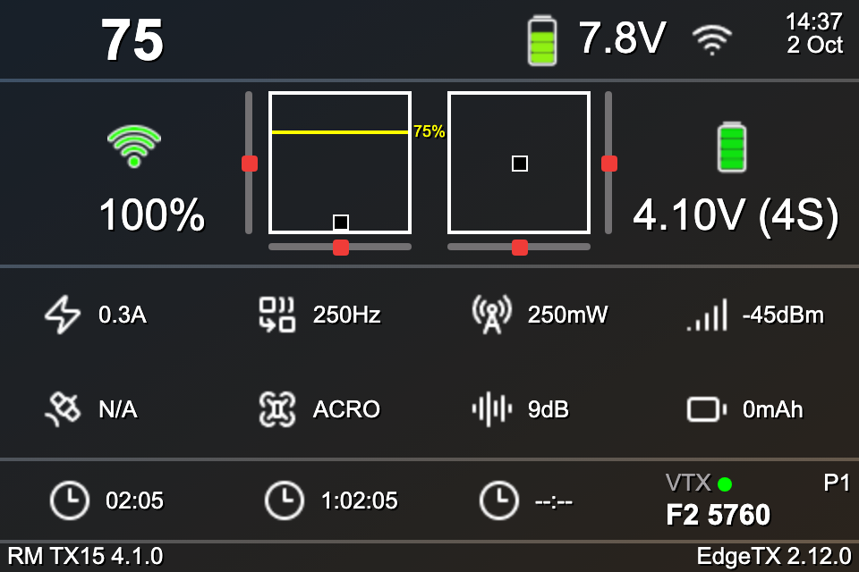
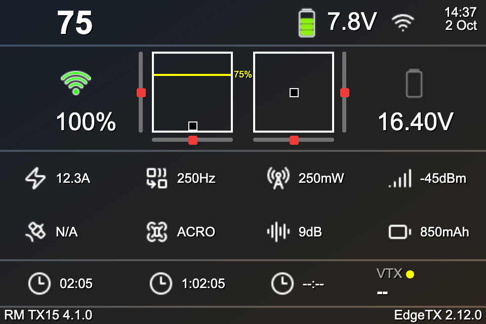
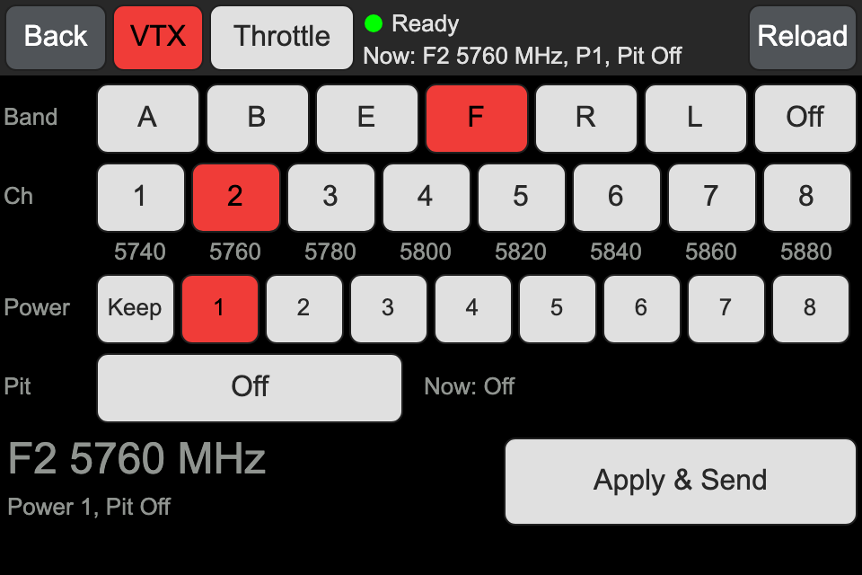
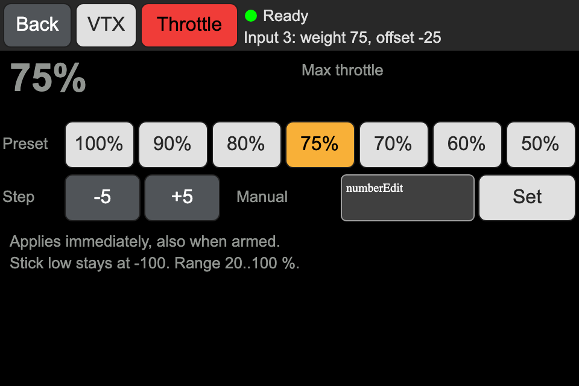

# FPVDASH — Telemetry Dashboard widget for EdgeTX

An EdgeTX Lua widget ("Telemetry Dashboard") for colour radios. It is made for the
RadioMaster TX15 (480x320) with an ExpressLRS module, and it works in other zone sizes.
It uses the EdgeTX LVGL Lua API, so it needs EdgeTX 2.11 or later (tested against the
2.12.0-rc1 and 2.12.x behaviour).

## Features

- **Dashboard:** model name, radio battery, link state, clock, stick monitor with trim
  bars, link quality and RX battery, an 8-cell telemetry grid, three timers, and the
  ELRS module version.
- **VTX control:** changes the VTX band, channel, power and pit mode through the
  "VTX Administrator" parameters of the ExpressLRS TX module, then sends them. The
  dashboard shows the current VTX setting.
- **Throttle cap:** sets a cap on the throttle input line of the model
  (weight = cap, offset = cap - 100). The change is glitch-free and applies at once.
  A line on the throttle box shows the cap, and the throttle dot shows the capped output.
- **Stick trail and update rate:** a faded trail behind the stick dots, and an optional
  update-rate readout in the footer.

## Screenshots

These images are renders of the real widget code from the desktop test harness
(`tests/out/*.svg`), at the TX15 screen size of 480x320.

| Dashboard | Dashboard, dark theme |
|---|---|
|  |  |
| **VTX page** | **Throttle cap page** |
|  |  |

## Install

### What you need

- A colour EdgeTX radio with EdgeTX 2.11 or later (the widget is made for the
  RadioMaster TX15 and EdgeTX 2.12).
- An ExpressLRS TX module (internal or external) for the VTX control. The dashboard
  works without it.
- A VTX that the flight controller controls (SmartAudio, Tramp or MSP), with the VTX
  table set in Betaflight or INAV, for the VTX page.

### Steps

1. Download this repository. Click **Code > Download ZIP** on GitHub, then extract the ZIP file.
2. Connect the radio to the computer with a USB cable.
3. On the radio, select **USB Storage (SD)**.
4. On the SD card, delete the folder `WIDGETS/FPVDASH` if it exists. This also removes old `.luac` files.
5. Copy the folder `radio sd card/WIDGETS/FPVDASH` from the download to the `WIDGETS` folder on the SD card.
6. Eject the SD card on the computer, then disconnect the cable.
7. Restart the radio.

### Add the widget to a screen

1. Open the screen setup. On most colour radios, push **TELE**, then go to the screen settings.
2. Select a screen, then select the layout **App mode** (full screen) or a layout with a large zone.
3. Select the zone, then select the widget **Telemetry Dashboard**.
4. Optional: open the widget settings to change the widget options (see below).

### Use the widget

- Long-press the widget (in App mode), or select **Full screen**, to open the **VTX** and **Throttle** pages.
- On the **VTX** page, select the band, the channel, the power and the pit mode. Then select **Apply**.
- On the **Throttle** page, select a cap. The change applies at once.
- Select **Back**, or push RTN for a short time, to go back to the dashboard.

### Update

Do steps 2 to 7 again. Always delete the old `FPVDASH` folder first.

## Widget options

A model that was saved with an older version of the widget loads every new option as 0,
so 0 is always the normal setting.

| Option | Values | Effect |
|---|---|---|
| `darkTheme` | 0 / 1 | Light or dark dashboard |
| `transpLevel` | 1..4 | Transparency of the dashboard panels |
| `vtxOff` | 0 / 1 | 1 = no VTX cell, no VTX page, no CRSF parameter traffic |
| `hideTrims` | 0 / 1 | 1 = no trim bars |
| `rxCells` | 0..14 | 0 = automatic RX cell count, 1..14 = fixed count |
| `extTrims` | 0..2 | Trim range: 0 = automatic, 1 = normal, 2 = extended |
| `trailOff` | 0 / 1 | 1 = no trail behind the stick dots |
| `showFps` | 0 / 1 | 1 = update rate in the footer |

## Repository layout

| Path | Content |
|---|---|
| `radio sd card/WIDGETS/FPVDASH/` | The widget (`main.lua`, `app.lua`, `lib/`, `ui/`, `icons/`) |
| `radio sd card/THEMES/*/theme.yml` | EdgeTX theme colours, read by the tests |
| `docs/DESIGN.md` | Design contract: module interfaces, runtime rules, layout |
| `tests/` | Desktop test harness (EdgeTX/LVGL mock, simulated ELRS module, scenarios) |
| `backup/FPVDASH-2026-10-02/` | The original lcd-based widget, for reference |

## Tests

The tests run the real widget files in a strict mock of the EdgeTX 2.12 Lua and LVGL API,
with a simulated ExpressLRS TX module. They need Lua 5.4 or later on the computer and the
EdgeTX Lua compiler for the exact syntax check. Get the compiler one time (it downloads
release v1.0.0 of [EdgeTX/edgetx-luac-action](https://github.com/EdgeTX/edgetx-luac-action/releases)
and checks its SHA-256 sum):

```sh
sh tools/get-edgetx-luac.sh
```

Then run the tests:

```sh
sh tests/check.sh
```

`check.sh` checks the syntax of every Lua file (with `tools/edgetx-luac` and with `luac`),
runs all scenarios for the rc1 and the 2.12.x firmware behaviour, and runs the unit tests.
Without `tools/edgetx-luac` it skips the EdgeTX syntax check and reports that as a problem.

## Limits

- EdgeTX runs Lua widgets every 50 ms, so the dashboard updates at most 20 times per
  second (the same as the EdgeTX channel monitor).
- The automatic RX cell count can count a pack that is not full as one cell less. Set
  `rxCells` for a model to give the exact count.
- The throttle cap works only on a plain throttle input line (one line, source Thr, no
  switch, no GVAR, no curve other than expo). For other set-ups the page tells why.

## License

MIT. See [LICENSE](LICENSE).
